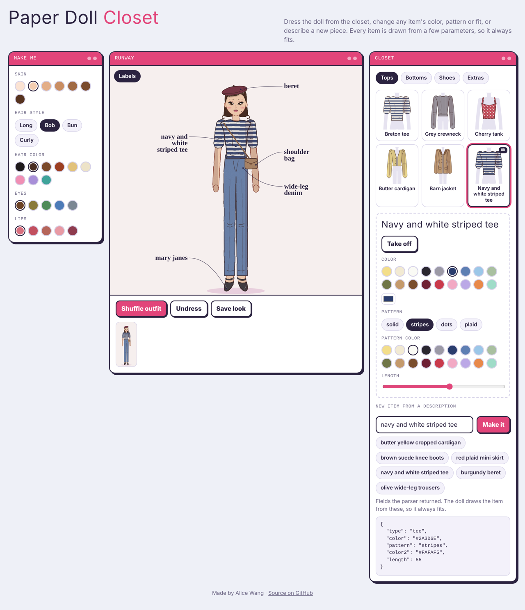

# Paper Doll Closet

A 2000s-style dress-up game with an ink-drawn paper doll. Dress her from the closet, change any item's color, pattern or fit, or describe a new piece ("red plaid mini skirt") and it appears on the doll.

**[Play it →](https://alicewang453.github.io/paper-doll-closet/)**



## How it works

**Every item is drawn from parameters, not from an image.** Each clothing template is a small function that takes four values (color, second color, pattern and length) and returns SVG shapes anchored to the doll's body. A mini skirt and a maxi skirt are the same template with a different `length`, and both start at the waistband, so items always fit. Patterns are SVG fills, so plaid, stripes and dots work on everything.

**The ink style is a rendering pass on top.** For each item the renderer:

1. Mutes the colors slightly toward a warm grey, so random combinations still look like one palette.
2. Draws the item a second time in white as a mask, then paints a hard-edged shadow band (and ribbing for knits) through it, so shading never spills outside the garment.
3. Adds the template's fold and crease lines as ink.

One SVG filter then runs over the whole doll: smooth noise slightly displaces every line so it looks hand-drawn, and fine noise adds paper grain.

**Descriptions become items.** A keyword parser turns text like "butter yellow cropped cardigan" into the same structured fields a template needs. It's a stand-in for a vision model, which would return those fields from a photo or a Pinterest pin.

## Project structure

```
src/
  doll/        body geometry, skin, hair and face
  items/       clothing templates, patterns and shared types
  render/      the ink renderer, the dressed-doll composer and closet thumbnails
  parse/       the description parser
  data/        palettes and the starter closet
  components/  React UI: avatar maker, runway, closet, item editor
```

## Run it locally

```bash
npm install
npm run dev     # start the dev server
npm test        # run the tests
npm run build   # type-check and build the site into dist/
```

The tests check that every template draws valid coordinates inside the doll at its smallest and largest settings, stays anchored to the body (tops at the shoulders, bottoms at the waist, shoes at the floor), and that the parser reads type, color, pattern and length correctly.

Every push to `main` is tested, built and deployed to GitHub Pages by GitHub Actions.

## Tech

React 18 · TypeScript · Vite · Vitest · SVG · GitHub Actions

## What's next

- A backend for saving wardrobes and outfits (FastAPI and Postgres)
- Photo upload: a vision model reads an outfit photo and adds its items to the closet
- A style report that analyzes a set of outfits for favorite colors, items and fits
- Connecting a Pinterest board through Pinterest's API
- Hand-drawn line art for the doll and items, recolored by the same code
